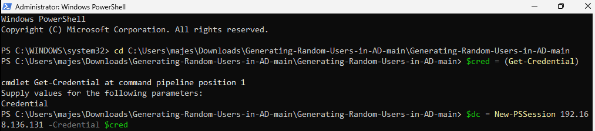
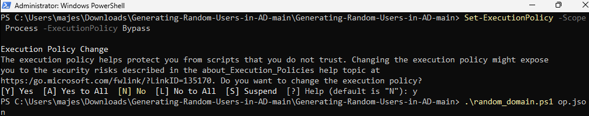
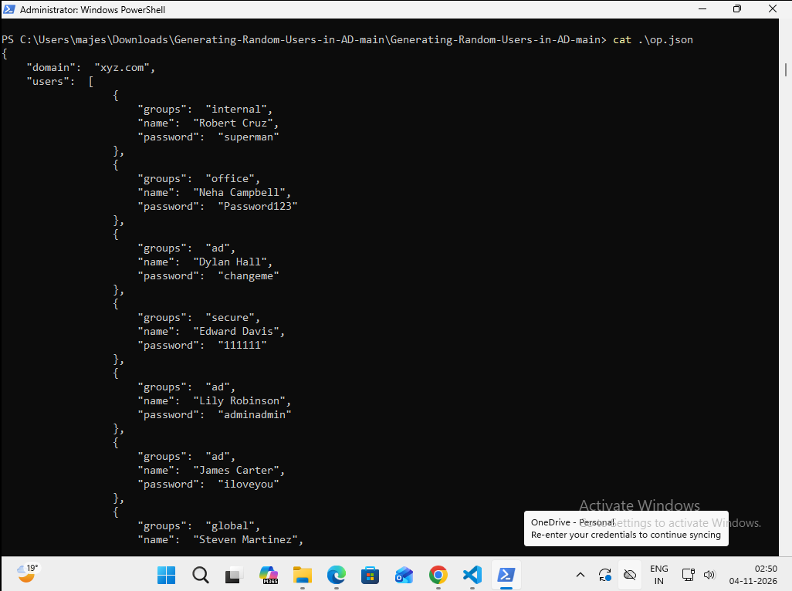
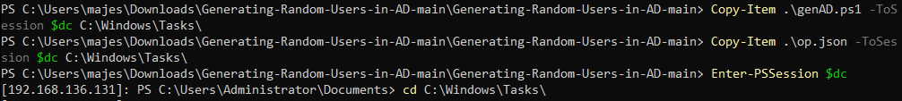
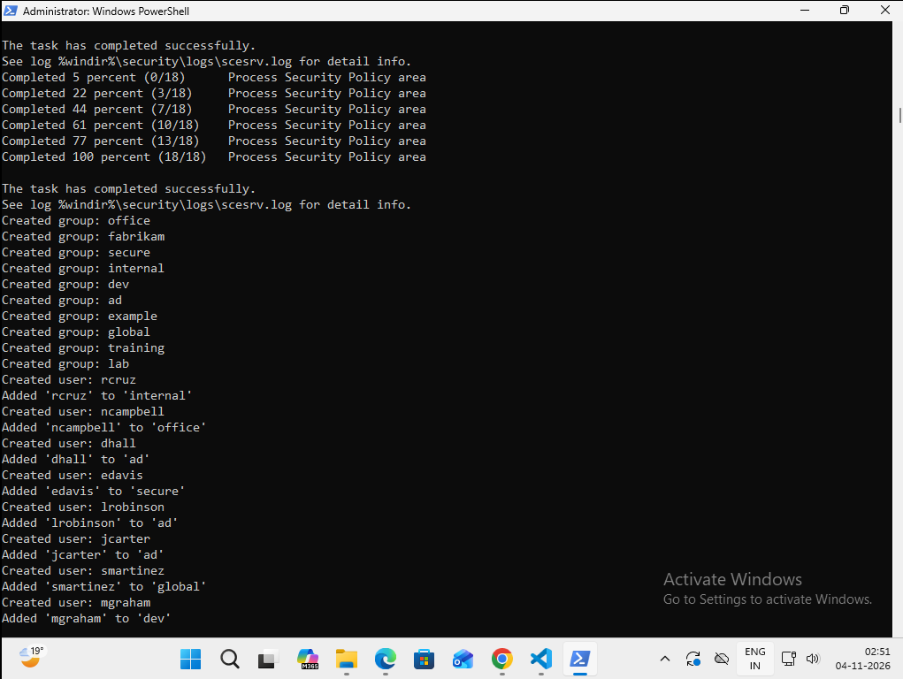
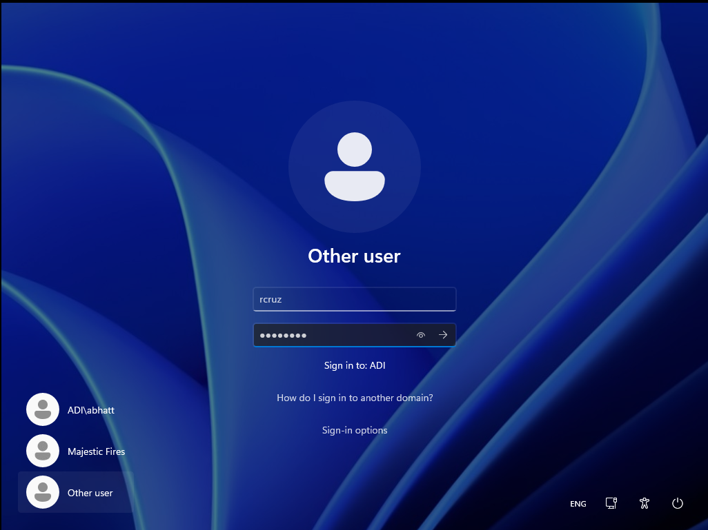
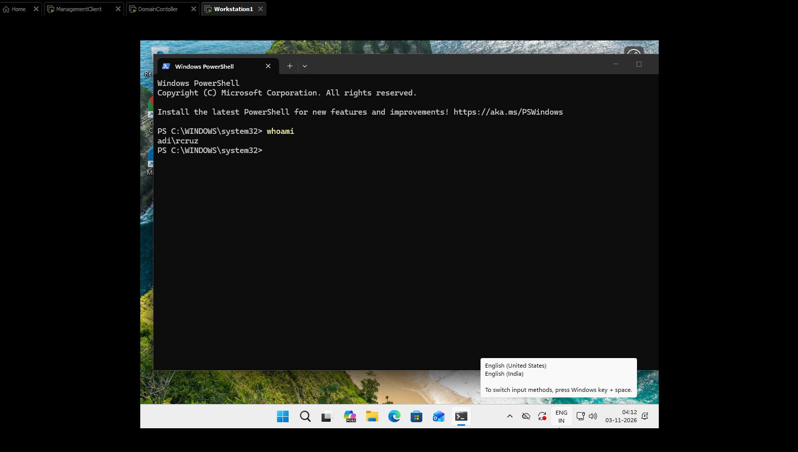

# Generating Random Domain Users and Groups in Active Directory

A PowerShell-based lab toolkit to generate randomized domain users, groups, and credentials, then automate their creation and group membership in Active Directory.

---

## Overview

This project extends my [Automating Domain Users in Active Directory](https://github.com/AdityaBhatt3010/Automating-Domain-Users-in-Active-Directory) repository with a randomized user and group generation workflow.

The objective is to create a disposable AD environment with realistic-looking users, randomized credentials, and group memberships for future security testing and lab experiments.

This is a testing tool, not a production-grade provisioning solution.

## Lab Environment

| Device | Operating System | Role |
|---|---|---|
| DC | Windows Server 2022 Evaluation Edition | Domain Controller |
| MC | Windows 11 | Management Console |
| WS | Windows 11 | Domain Workstation |

### Command Key

- `DC:` Commands executed on the Domain Controller.
- `MC:` Commands executed on the Management Console.
- `WS:` Commands executed on the Workstation.
- `ps:` PowerShell command, run as Administrator unless otherwise specified.
- `cmd:` Command Prompt command.

## Prerequisites

- An existing AD domain. For the AD setup guide, refer to [Active-Directory-Setup](https://github.com/AdityaBhatt3010/Active-Directory-Setup).
- PowerShell remoting enabled and configured between MC and DC.
- Active Directory PowerShell module installed on DC.
- Git and Visual Studio Code installed on MC.

### Install Git

MC: PowerShell (Administrator)

```powershell
winget install --id Git.Git -e --source winget
```

### Install Visual Studio Code

Download from [Visual Studio Code](https://code.visualstudio.com/download).

## Repository Structure

```text
Generating-Random-Users-in-AD/
├── README.md
├── genAD.ps1
├── random_domain.ps1
├── op.json
├── data/
│   ├── group_names.txt
│   ├── first_names.txt
│   ├── last_names.txt
│   └── passwords.txt
└── AD/
    └── 3/
        ├── 1.png
        ├── 2.png
        ├── 3.png
        ├── 4.png
        ├── 5.png
        ├── 6.png
        └── 7.png
```

## Workflow

1. Generate randomized domain configuration data on MC.
2. Serialize the generated users and groups into JSON.
3. Transfer the configuration and provisioning script to DC.
4. Create AD groups and users on DC.
5. Assign users to their generated groups.
6. Verify a generated account by logging in from WS.

---

## 1. Generate Randomized Domain Data

### Payload: `random_domain.ps1`

This script selects random group names, first names, surnames, and passwords from the files in `data/`. It builds a JSON configuration containing the domain, groups, and users.

```powershell
param(
    [Parameter(Mandatory = $true)]
    $OutputJSONFile
)

$group_names = [System.Collections.ArrayList](Get-Content "data/group_names.txt")
$first_names = [System.Collections.ArrayList](Get-Content "data/first_names.txt")
$last_names = [System.Collections.ArrayList](Get-Content "data/last_names.txt")
$passwords = [System.Collections.ArrayList](Get-Content "data/passwords.txt")

$groups = @()
$users = @()

$num_groups = 10

for ($i = 0; $i -lt $num_groups; $i++) {
    $group_name = Get-Random -InputObject $group_names
    $group = @{ "name" = "$group_name" }
    $groups += $group
    $group_names.Remove($group_name)
}

$num_users = 100

for ($i = 0; $i -lt $num_users; $i++) {
    $first_name = Get-Random -InputObject $first_names
    $last_name = Get-Random -InputObject $last_names
    $password = Get-Random -InputObject $passwords

    $new_user = @{
        "name"     = "$first_name $last_name"
        "password" = "$password"
        "groups"   = (Get-Random -InputObject $groups).name
    }

    $users += $new_user

    $first_names.Remove($first_name)
    $last_names.Remove($last_name)
    $passwords.Remove($password)
}

@{
    "domain" = "xyz.com"
    "groups" = $groups
    "users"  = $users
} | ConvertTo-Json -Depth 5 | Out-File $OutputJSONFile
```

### What the script does

- Loads the source lists into mutable collections.
- Selects 10 group names without replacement.
- Generates 100 users using randomly selected first names and surnames.
- Assigns each user a randomly selected password and one group.
- Removes selected entries from the source collections to reduce reuse.
- Exports the resulting configuration to JSON.

The generated JSON acts as the input payload for the AD provisioning script.

### MC: Generate the configuration

Clone the repository and navigate into it:

```powershell
git clone https://github.com/AdityaBhatt3010/Generating-Random-Users-in-AD.git

cd .\Generating-Random-Users-in-AD\
```

If Git is unavailable, download and extract the repository ZIP instead.

Create a remote session to DC:

```powershell
$cred = Get-Credential

$dc = New-PSSession 192.168.136.131 -Credential $cred
```



Generate the JSON configuration:

```powershell
Set-ExecutionPolicy -Scope Process -ExecutionPolicy Bypass

.\random_domain.ps1 op.json
```



The execution policy bypass applies only to the current PowerShell process. Use it only for scripts you have reviewed and trust.

Inspect the generated configuration:

```powershell
cat .\op.json
```



The JSON contains the domain name, generated groups, and user objects with their passwords and group assignments.

---

## 2. Provision Active Directory

### Payload: `genAD.ps1`

This script reads the generated JSON and creates the corresponding AD groups and users.

```powershell
param(
    [Parameter(Mandatory = $true)]
    [string]$JSONFile
)

Import-Module ActiveDirectory -ErrorAction Stop

# Load JSON configuration
$json = Get-Content -Path $JSONFile -Raw | ConvertFrom-Json
$Global:Domain = $json.domain

function CreateADGroup() {
    param(
        [Parameter(Mandatory = $true)]
        $groupObject
    )

    $name = $groupObject.name

    try {
        New-ADGroup -Name $name -GroupScope Global -ErrorAction Stop
        Write-Host "Created group: $name"
    }
    catch {
        Write-Warning "Could not create group '$name': $_"
    }
}

function RemoveADGroup() {
    param(
        [Parameter(Mandatory = $true)]
        $groupObject
    )

    $name = $groupObject.name
    Remove-ADGroup -Identity $name -Confirm:$False
}

function CreateADUser() {
    param(
        [Parameter(Mandatory = $true)]
        $userObject
    )

    # Pull name and password from JSON object
    $name = $userObject.name
    $password = $userObject.password

    # Split full name into first name and last name
    $firstname, $lastname = $name.Split(" ", 2)

    # Generate username: first initial + last name
    $username = ($firstname[0] + $lastname).ToLower()

    $samAccountName = $username
    $principalName = "$username@$Global:Domain"

    try {
        New-ADUser -Name $name -GivenName $firstname -Surname $lastname -SamAccountName $samAccountName -UserPrincipalName $principalName -AccountPassword (ConvertTo-SecureString $password -AsPlainText -Force) -Enabled $true -ErrorAction Stop

        Write-Host "Created user: $username"
    }
    catch {
        Write-Warning "Could not create user '$name': $_"
        return
    }

    # Add user to groups
    foreach ($group_name in $userObject.groups) {
        try {
            Get-ADGroup -Identity $group_name -ErrorAction Stop |
                Out-Null

            Add-ADGroupMember -Identity $group_name -Members $samAccountName -ErrorAction Stop

            Write-Host "Added '$username' to '$group_name'"
        }
        catch {
            Write-Warning "Could not add '$username' to '$group_name': $_"
        }
    }
}

function RemoveADUser() {
    param(
        [Parameter(Mandatory = $true)]
        $userObject
    )

    $name = $userObject.name
    $firstname, $lastname = $name.Split(" ")
    $username = ($firstname[0] + $lastname).ToLower()
    $samAccountName = $username

    Remove-ADUser -Identity $samAccountName -Confirm:$False
}

function WeakenPasswordPolicy() {
    secedit /export /cfg C:\Windows\Tasks\secpol.cfg

    (Get-Content C:\Windows\Tasks\secpol.cfg).
        replace("PasswordComplexity = 1", "PasswordComplexity = 0").
        replace("MinimumPasswordLength = 7", "MinimumPasswordLength = 1") |
        Out-File C:\Windows\Tasks\secpol.cfg

    secedit /configure /db C:\Windows\security\local.sdb /cfg C:\Windows\Tasks\secpol.cfg /areas SECURITYPOLICY

    Remove-Item -Force C:\Windows\Tasks\secpol.cfg -Confirm:$false
}

WeakenPasswordPolicy

# Create groups
foreach ($group in $json.groups) {
    CreateADGroup $group
}

# Create users
foreach ($user in $json.users) {
    CreateADUser $user
}
```

### What the script does

- Imports the Active Directory module and reads the JSON configuration.
- Creates global security groups from the generated group objects.
- Builds usernames using the first initial and surname.
- Creates enabled AD accounts with the supplied credentials.
- Adds each user to the group specified in the JSON.
- Includes helper functions for removing users and groups.

The removal functions are included for future cleanup workflows but are not called during this provisioning run.

**Lab caution:** The `WeakenPasswordPolicy` function modifies the DC's local security policy. It does not directly change the domain password policy. Avoid weakening password controls outside an isolated disposable lab.

### MC: Transfer files and connect to DC

```powershell
Copy-Item .\genAD.ps1 -ToSession $dc C:\Windows\Tasks\

Copy-Item .\op.json -ToSession $dc C:\Windows\Tasks\

Enter-PSSession $dc

cd C:\Windows\Tasks\
```



### DC: Execute provisioning

```powershell
.\genAD.ps1 .\op.json
```



The script creates the generated groups, creates users, and assigns group memberships. Successful operations are printed to the console.

---

## 3. Verify Domain Authentication

From WS, attempt to log in using one of the generated domain accounts.

For example, if the generated account is `rcruz` with password `superman`, use:

```text
Username: xyz\rcruz
Password: superman
```



After logging in, open PowerShell on WS and run `whoami` to verify the authenticated domain identity.

### WS: Verify the logged-in identity

```powershell
whoami
```



The output should identify the logged-in account as `adi\rcruz`, confirming that the workstation session is authenticated as the domain user.

---

## Notes and Limitations

- This project is intended for lab and testing environments only.
- Generated passwords are intentionally weak test credentials.
- Username collisions may occur when different people share the same surname and first initial.
- The scripts do not implement production-grade logging, rollback, or idempotency.
- The configuration currently assigns one group per user.
- Review the scripts and generated JSON before executing them against any domain.

## References

- [Active Directory Setup](https://github.com/AdityaBhatt3010/Active-Directory-Setup)
- [Automating Domain Users in Active Directory](https://github.com/AdityaBhatt3010/Automating-Domain-Users-in-Active-Directory)
- [Git](https://git-scm.com/)
- [Visual Studio Code](https://code.visualstudio.com/download)

---

This is not production-grade, clearly. It is a lab environment I will probably be messing with in future repositories.

Stay tuned at [AdityaBhatt3010](https://github.com/AdityaBhatt3010). Here, we build production-grade tools, but we begin with testing tools, break them, make them production-grade, and guess what... break production-grade tools as well. 💀👍

---
